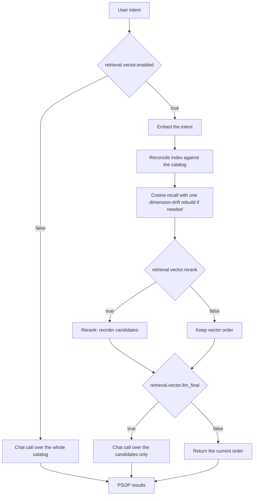

# PSOP intent retrieval

The center resolves a user intent to a PSOP workflow (an AIOps scenario) and, when
execution needs it, to the top N candidates. Two retrieval modes exist, selected by
`retrieval.vector.enabled` in `etc/conf/server.conf`.

| Mode | Behaviour |
|---|---|
| `false` (default) | One chat call reads the **whole** PSOP catalog |
| `true` | Embedding recall first, then optional rerank, then the LLM chooses |

## The index is a derived cache

The PSOP catalog is the only source of truth. The embedding index is a cache that
can be deleted at any time and rebuilt on the next search.

- **Location**: `retrieval.vector.index_file`, by default
  `data/vector_index/psop_vectors.json`. It is runtime data and is never committed.
- **Invalidation**: every PSOP is keyed by a hash of the exact text that was
  embedded (name, description, tags, user intent, task summary). An edited PSOP is
  re-embedded, an untouched one costs no network call, and a deleted PSOP is pruned
  so search can never return a stale id.
- **Model and dimension changes**: the cache records the embedding model name and
  a SHA-256 fingerprint of the model, endpoint, request template/options and response
  mapping (not their plaintext values or authentication credentials). A changed
  fingerprint discards the cache, even when dimensions stay the same. A query
  dimension mismatch triggers one full rebuild and retry, including with an
  unchanged catalog or after restart. If the provider remains inconsistent, the
  usual `strict`/catalog-fallback policy applies; there is no unbounded retry.
- **Cache integrity**: invalid JSON/root structure is discarded; rows with invalid
  dimensions, nonnumeric/boolean/nonfinite values are re-embedded. Valid rows are
  reused. Rebuilding replaces the previous generation only after every document
  succeeds. Version-1 caches are rebuilt once when upgrading.
- **Persistence failures**: a missing, corrupt or unwritable index degrades to a
  rebuild or to an in-memory index. Rebuilding still requires a healthy embedder.
- **Concurrency**: the file is written atomically through a temporary file and
  `os.replace`. Independent processes may each keep their own in-memory copy and
  last-writer-wins the cache, which is safe because every pass reconciles with the
  catalog. Within a retrieval instance, reconcile/rebuild/search are serialized
  so concurrent requests cannot observe a partially updated generation. Remote
  query embeddings run outside that lock and can proceed concurrently.

A vector database is deliberately not a dependency of this feature: with a few
hundred PSOPs, an in-process cosine scan answers in well under a millisecond. The
index interface is a cache boundary, so a Milvus adapter could be added behind it
without touching the retrieval code.

## Configuration

| Key | Default | Meaning |
|---|---|---|
| `retrieval.vector.enabled` | `false` | Turns embedding recall on |
| `retrieval.vector.top_k` | `20` | Recall depth handed to rerank and the final choice |
| `retrieval.vector.min_score` | `0.0` | Minimum cosine similarity to keep a candidate |
| `retrieval.vector.rerank` | `false` | Reorder candidates with the `rerank` model |
| `retrieval.vector.llm_final` | `true` | Let the LLM choose among the candidates |
| `retrieval.vector.strict` | `false` | Fail the search when embeddings are unavailable |
| `retrieval.vector.index_file` | `data/vector_index/psop_vectors.json` | Cache location |
| `retrieval.llm.thinking` | `true` | `true`: retain model defaults; `false`: override with `thinking: {"type": "disabled"}` for every retrieval selection call |

The `embed` capability must be configured in `etc/config/models.yaml` before the
switch is turned on. `rerank` is only read when `retrieval.vector.rerank=true`.
The thinking policy applies to whole-catalog selection, vector final selection
and fallback alike. The override does not modify the shared chat client or the
model definition; the gateway must support this provider-specific option.

## Failure behaviour

| Failure | Result |
|---|---|
| Embedding model unavailable, `strict=false` | Warning, then the LLM path answers the query |
| Embedding model unavailable, `strict=true` | The error propagates to the caller |
| Recall filters every candidate, e.g. `min_score` above the corpus similarity | Warning, then the LLM path answers |
| Reranker unavailable or returning no order | Warning, then the vector order is kept |
| Final selection fails, is malformed, or names only unknown candidates | Keep vector order; log call failures and unknown selections |
| Final selection returns a valid empty array `[]` | Return no match; do not replace it with vector candidates or retry the catalog |
| Index file corrupt or unwritable | Warning, then rebuild or in-memory index |

Infrastructure failure must not be confused with a valid business rejection:
a broken embedding endpoint falls back to the catalog by default, while an
explicit `[]` from final selection means "no matching PSOP". Setting
`llm_final=false` deliberately bypasses this semantic selection and returns ranks.

## Measured cost

Measured on the bundled 22-PSOP catalog with the chat model in `etc/config/models.yaml`:

| Setup | Prompt | Latency |
|---|---|---|
| Full catalog, thinking on | 28,123 chars | 24–27 s |
| Full catalog, thinking off | 28,123 chars | 1.1 s |
| Trimmed candidates, thinking on | 7,818 chars | 26.9 s |
| 220 candidates, thinking off | 269,142 chars | 1.6 s |

Two conclusions drive the defaults: candidate count is **not** the dominant cost at
this scale, and reasoning dominates the chat call. Enable
`retrieval.llm.thinking=false` only where the gateway accepts the field. It is a
latency trade-off that must be re-checked against your own model.
