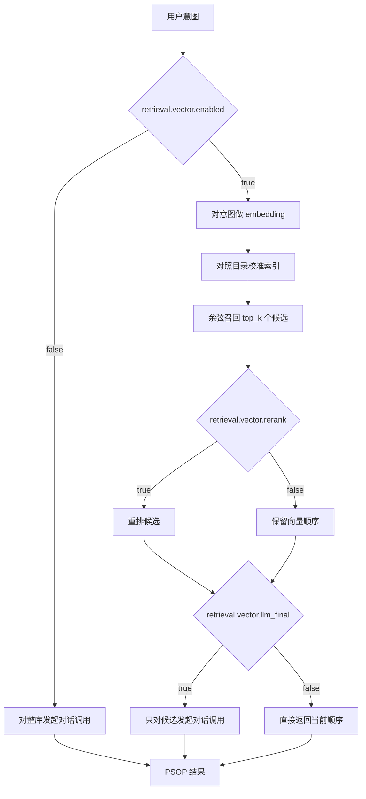

# PSOP 意图检索

编排中心把用户意图解析为 PSOP 工作流（AIOps 场景），执行需要时还会返回前 N 个候选。
检索有两种模式，由 `etc/conf/server.conf` 中的 `retrieval.vector.enabled` 选择。

| 模式 | 行为 |
|---|---|
| `false`（默认） | 一次对话调用读取**整个** PSOP 目录 |
| `true` | 先用 embedding 召回，再按需重排，最后由 LLM 在候选内选择 |

## 索引是派生缓存

PSOP 目录是唯一的真相源。embedding 索引只是缓存，可以随时删除，下次检索自动重建。

- **位置**：`retrieval.vector.index_file`，默认 `data/vector_index/psop_vectors.json`。
  属于运行时数据，不提交入库。
- **失效判定**：每个 PSOP 以「实际被嵌入的那段文本」（名称、描述、标签、用户意图、
  任务摘要）的哈希为键。被编辑过的重新嵌入，未改动的不产生网络调用，已删除的会被
  剔除，因此检索永远不会返回过期 ID。
- **模型与维度变化**：缓存记录 embedding 模型名，换模型即整库丢弃；向量维度变化时
  整库重建，绝不混用不可比的向量。
- **检索期只读**：索引缺失、损坏或不可写，只会退化为重建或纯内存索引，不会让检索本身失败。
- **并发**：文件通过临时文件加 `os.replace` 原子写入。多进程各自持有内存副本、缓存
  「后写者胜」，这是安全的，因为每一轮都会对照目录校准。

本特性刻意不引入向量数据库依赖：几百个 PSOP 时，进程内余弦扫描远低于 1 毫秒。
索引是缓存边界，将来在它背后接入 Milvus 适配器不需要改动检索代码。

## 配置项

| 键 | 默认值 | 含义 |
|---|---|---|
| `retrieval.vector.enabled` | `false` | 是否开启 embedding 召回 |
| `retrieval.vector.top_k` | `20` | 交给重排与终选的召回深度 |
| `retrieval.vector.min_score` | `0.0` | 保留候选的最低余弦相似度 |
| `retrieval.vector.rerank` | `false` | 用 `rerank` 模型重排候选 |
| `retrieval.vector.llm_final` | `true` | 由 LLM 在候选内做最终选择 |
| `retrieval.vector.strict` | `false` | embedding 不可用时是否让检索失败 |
| `retrieval.vector.index_file` | `data/vector_index/psop_vectors.json` | 缓存位置 |
| `retrieval.llm.thinking` | `true` | 选择类调用是否发送 `thinking: {"type": "disabled"}` |

开启开关前，必须在 `etc/config/models.yaml` 中配置好 `embed` 能力。只有
`retrieval.vector.rerank=true` 时才会读取 `rerank`。

## 失败行为

| 失败情形 | 结果 |
|---|---|
| embedding 不可用且 `strict=false` | 记录告警，退回 LLM 路径回答 |
| embedding 不可用且 `strict=true` | 错误向上抛出 |
| 候选被 `min_score` 全部过滤 | 记录告警，退回 LLM 路径回答 |
| 重排不可用或返回空顺序 | 记录告警，保留向量顺序 |
| 终选调用失败，或没有选中任何候选 | 记录告警，保留向量顺序 |
| 索引损坏或不可写 | 记录告警，重建或使用内存索引 |

因此向量路径总是向「目录」退化，而不是向「空结果」退化：embedding 端点坏掉，
绝不能被读成「没有匹配的 PSOP」。

## 实测成本

在内置 22 个 PSOP 的目录上，使用 `etc/config/models.yaml` 的对话模型测得：

| 配置 | 提示词 | 耗时 |
|---|---|---|
| 整库，开启思考 | 28,123 字符 | 24–27 秒 |
| 整库，关闭思考 | 28,123 字符 | 1.1 秒 |
| 候选瘦身，开启思考 | 7,818 字符 | 26.9 秒 |
| 220 个候选，关闭思考 | 269,142 字符 | 1.6 秒 |

这两条结论决定了默认值：在这个量级上，候选数量**不是**主要成本，思考才是。
`retrieval.llm.thinking=false` 只在网关接受该字段时启用，并且属于需要用你自己的
模型重新验证的延迟取舍。
